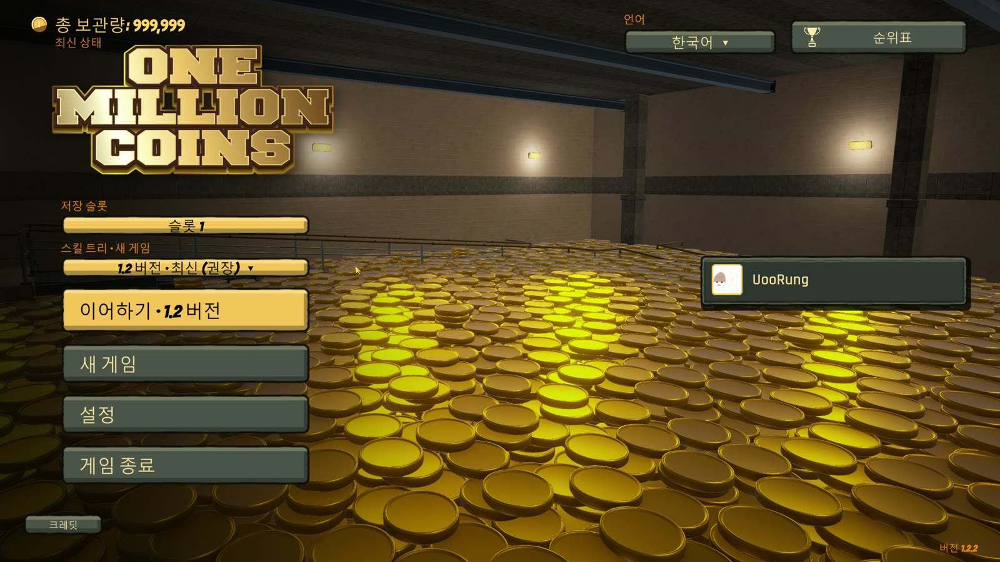
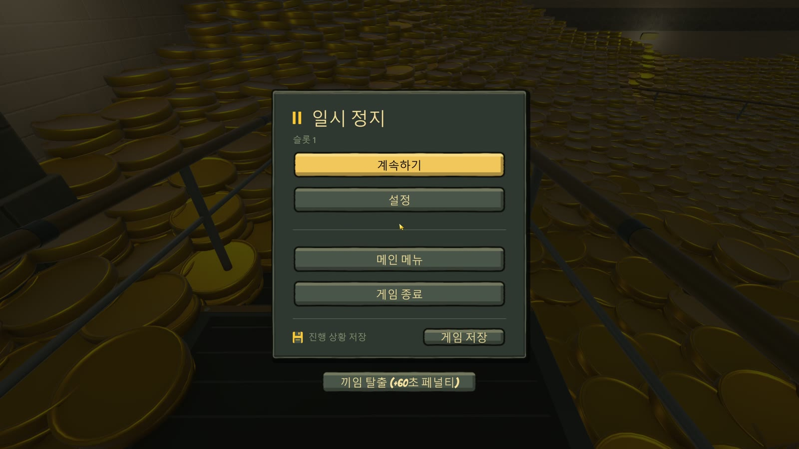
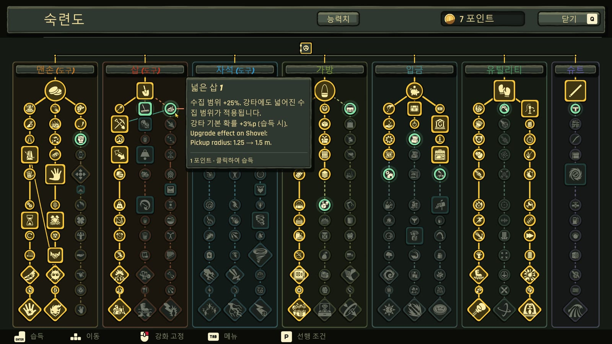
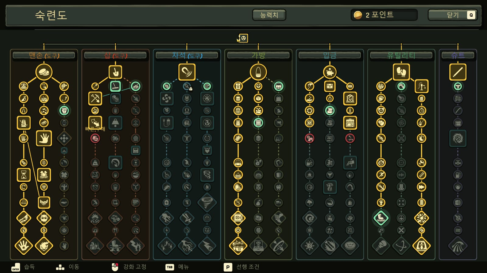

# One Million Coins 한글 패치

  

  <b>⬇️ <a href="https://github.com/dong0902hee/OneMillionCoins-Korean/releases/latest/download/OneMillionCoins_KoreanPatch.zip">한글 패치 다운로드 (최신 버전 zip)</a></b> 
  이전 버전과 변경 내역: <a href="https://github.com/dong0902hee/OneMillionCoins-Korean/releases">Releases</a>

Steam 게임 [One Million Coins](https://store.steampowered.com/app/5258340/One_Million_Coins/)의 **비공식 한국어 패치**입니다.
메뉴, 설정, 숙련도(스킬 트리) 238개, 화면 안내 문구와 툴팁까지 거의 모든 글자가 한국어로 나옵니다.

  
  
  
  

## 설치 방법

1. 위 **다운로드** 버튼으로 zip을 받아 **압축을 모두 풉니다.**
2. 게임을 완전히 종료합니다.
3. **`한글패치_설치.bat`** 을 더블클릭합니다.
   - Steam 설치 정보를 읽어서 게임 폴더를 자동으로 찾습니다.
   - 못 찾으면 폴더 선택 창이 뜹니다. `One Million Coins.exe`가 있는 폴더를 고르세요.
4. Steam에서 게임을 실행합니다. 설정의 언어가 **한국어**(원래 ENGLISH 자리)로 되어 있으면 됩니다.

**제거:** `한글패치_제거.bat` 을 더블클릭하면 패치 파일만 지우고 원래대로 돌아갑니다.

## 자주 묻는 것

- **한글이 안 나와요** → 게임을 완전히 껐다 켜세요. 언어를 다른 언어(DEUTSCH, 日本語 등)로 바꾸면 한글이 사라집니다.
- **백신이나 브라우저가 경고해요** → `winhttp.dll`은 모드를 불러오는 로더(Unity Doorstop)라서 경고가 뜰 수 있습니다. 소스는 이 저장소에 모두 공개되어 있습니다.
- **게임이 업데이트됐더니 일부가 영어로 나와요** → 새로 추가된 문구입니다. [Issues](https://github.com/dong0902hee/OneMillionCoins-Korean/issues)에 스크린샷과 함께 알려 주세요. 게임 폴더의 `Translation\untranslated.txt` 파일을 같이 올려 주시면 더 빨리 고칠 수 있습니다.
- **영어로 남는 부분** → 강타 효과 `HEAVY STRIKE +N`, 입금기 위 `TOTAL DEPOSITED`는 글자가 아니라 그림이라 바꿀 수 없습니다.
- **설치 방법을 그림으로 보고 싶어요** → [희셈랩 블로그 글](https://heesamlab.blogspot.com/2026/11/one-million-coins.html), [스팀 한국어 가이드](https://steamcommunity.com/sharedfiles/filedetails/?id=3840722958)

## 용어

| 원문 | 번역 |
|---|---|
| Deposit | 입금 |
| Flow | 플로우 |
| Two-handed grip / Perfect grip | 양손 그립 / 완벽한 양손 그립 |
| Heavy Strike | 강타 |
| Magnet Pulse | 자기 펄스 |
| Jackhammer | 잭해머 |
| Pocket Bank | 포켓 뱅크 |

## 저장소 구성

| 경로 | 내용 |
|---|---|
| `Translation/locales/ko.yaml` | 한국어 번역 파일 (UI, 숙련도, 툴팁 정규식) |
| `src/TranslationLoader.cs` | 번역 로더 소스 (원본 모드를 한국어 UI에 맞게 수정) |
| `installer/` | 설치·제거 배치 파일과 PowerShell 스크립트 |
| `bin/` | 로더 실행 파일 (TranslationLoader.dll, 0Harmony.dll, winhttp.dll) |
| `build_release.ps1` | 배포용 zip을 만드는 스크립트 |

번역 수정 제안은 Pull Request나 Issue로 환영합니다. `ko.yaml`만 고쳐도 됩니다.

## 출처와 라이선스

- 비공식 팬 번역이며 게임 개발사(OYU Games)와 관계없습니다. 게임 파일은 포함되어 있지 않으며 정품 게임이 필요합니다.
- 게임의 원문 텍스트와 상표의 권리는 개발사에 있습니다. 개발사가 요청하면 배포를 중단합니다.
- 번역 모드 원본: [Zaki-XL/One-Million-Coins-Translation](https://github.com/Zaki-XL/One-Million-Coins-Translation) (작성자가 권리를 주장하지 않음, CC0 상당)
- 한국어 번역과 로더 수정분: [MIT License](LICENSE)
- 포함된 외부 구성 요소: [THIRD_PARTY_NOTICES.md](THIRD_PARTY_NOTICES.md)
